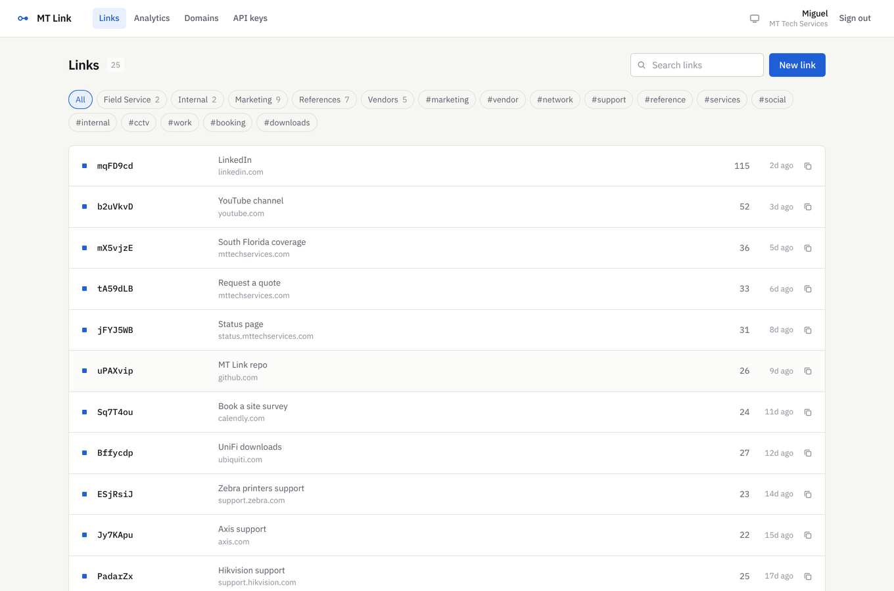
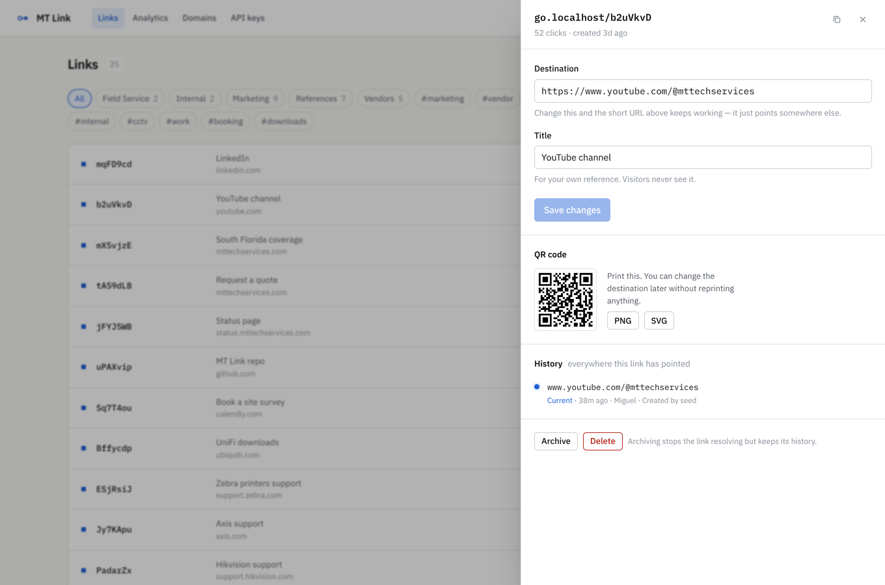
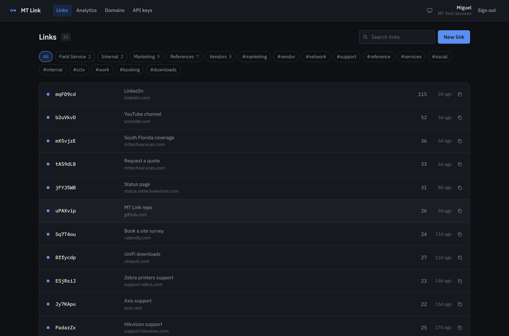
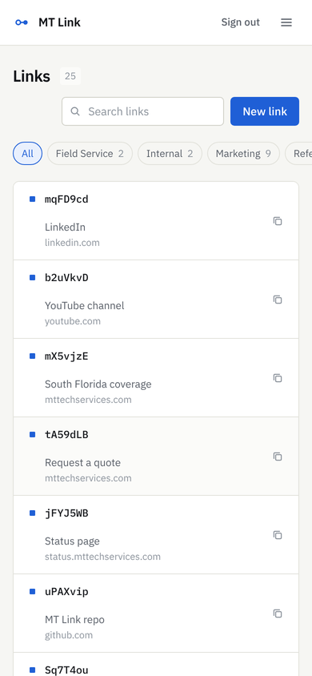
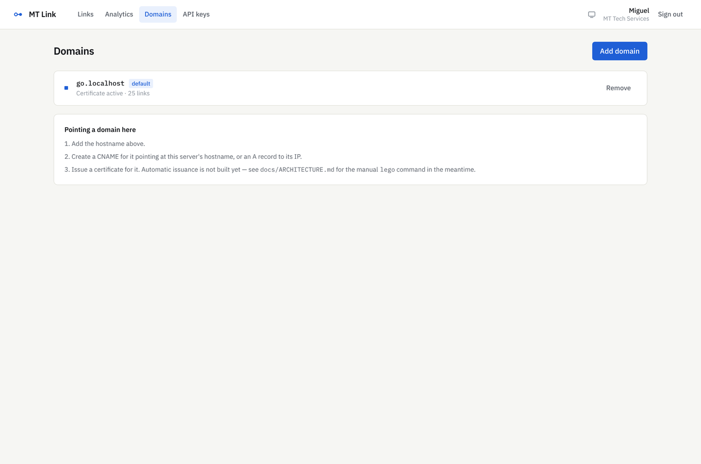
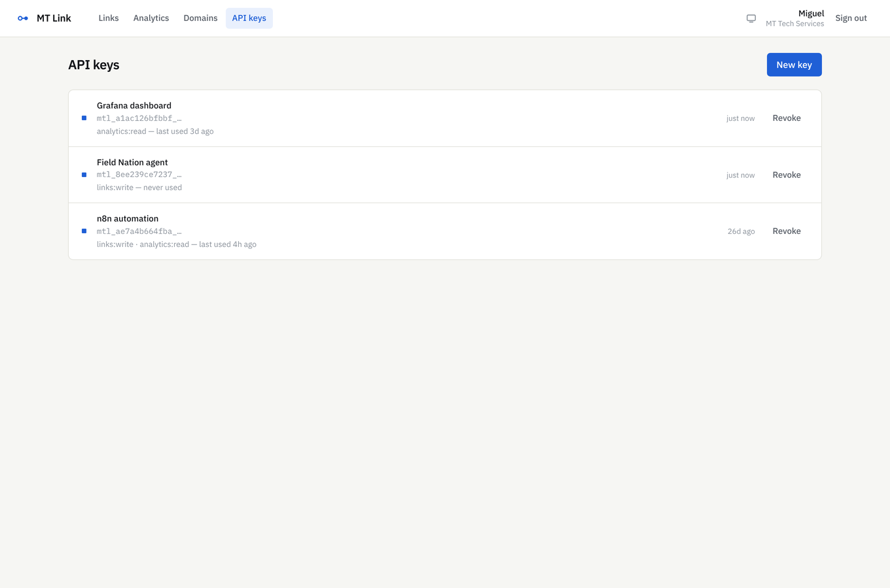

# MT Link

A self-hosted branded link shortener and redirect platform. Functionally
comparable to Short.io, running entirely on infrastructure you own.

Built for MT Tech Services LLC, where short links end up on printed work
orders and stuck to equipment racks — so the thing that matters is that the
label stays valid while the target moves.

---

## What it does

- **Short links on your own domains**, with a mutable destination. Change
  where a link points without changing the link.
- **Full change history.** Every destination a link has ever had, who
  changed it, and when.
- **Click analytics** — countries, devices, browsers, referrers — with
  no raw IP addresses stored anywhere.
- **QR codes** (PNG and SVG) generated per link.
- **A REST API** with scoped keys, plus CSV import and export.
- **A dashboard** that works on a phone.

---

## Screens

The links register. A short link is a label on something physical — a QR on
a printed work order, a sticker on a rack — so the view is a schedule of
labelled ports rather than a grid of cards: status, slug, and where it
points right now, on one scannable line.



The link detail drawer. The destination field and the history below it tell
the same story twice: here is where this points, and here is everywhere it
has pointed. Changing the destination leaves the short URL and any printed
QR code untouched.



Analytics. Ranges of 30 days or less read the raw partitions and are live to
the second; longer ranges switch to the daily rollup, which the response
labels so you always know which you are looking at.


Dark mode throughout, and the register works on a phone.

<p>
  
  
</p>

Domains and API keys.

<p>
  
  
</p>

---

## Quick start

### On a server

```bash
git clone https://github.com/migtam628/url_shortener.git
sudo bash url_shortener/scripts/bootstrap-vps.sh \
  --domain go.yourdomain.com --email you@yourdomain.com --dry-run
```

Drop `--dry-run` once it reports clean. The dry run checks the things that
actually break a first deploy — something already holding port 80 or 443,
DNS not pointing at this host, not enough RAM — and changes nothing.

The script generates real secrets, issues certificates, configures the
firewall, builds and starts the stack, runs migrations, and installs
systemd timers for verified nightly backups and weekly GeoIP refresh. It is
idempotent; re-running it updates the checkout without touching your
`.env`. Details in [docs/DEPLOYMENT.md](docs/DEPLOYMENT.md).

### Locally

```bash
git clone https://github.com/migtam628/url_shortener.git mt-link
cd mt-link
cp .env.example .env
make certs-dev                # self-signed cert for local HTTPS
docker compose up --build
make migrate
make seed
```

Dashboard on `http://localhost:5173`, API on `:4000`, redirects on `:4001`.
The seed prints the login it created.

Before anything is exposed to the internet, change `SESSION_SECRET`,
`IP_HASH_SECRET`, `POSTGRES_PASSWORD` and the seeded account password, and
set `ALLOW_REGISTRATION=false`.

```bash
openssl rand -base64 48   # SESSION_SECRET
openssl rand -base64 32   # IP_HASH_SECRET
```

---

## Architecture

```
                    ┌──────────────── nginx ────────────────┐
                    │  TLS, real client IP, compression     │
                    └───┬───────────────────────────────┬───┘
     short domains ─────┘                               └───── app.<domain>
            │                                                      │
            ▼                                                      ▼
   ┌──────────────────┐                                  ┌──────────────────┐
   │ redirect service │  LRU → Redis → Postgres          │   API service    │
   │  stateless, xN   │  ──────────────────────▶         │  + dashboard SPA │
   └────────┬─────────┘                                  └────────┬─────────┘
            │ click (fire and forget)                             │
            ▼                                                     ▼
      ┌───────────┐         ┌──────────────┐              ┌──────────────┐
      │   Redis   │────────▶│ click worker │─────────────▶│  PostgreSQL  │
      │  (BullMQ) │         │ geo, UA, hash│              │  partitioned │
      └───────────┘         └──────────────┘              └──────────────┘
```

Four decisions worth knowing about, because the rest follows from them:

**The redirect path never blocks on anything optional.** A click is pushed
to a queue without awaiting; if Redis is unreachable the click is dropped
and counted, and the visitor still gets their redirect at full speed.
Losing analytics is acceptable. Delaying a redirect is not.

**Cache invalidation deletes before it publishes.** The Redis key is removed
first (authoritative), then a pub/sub message tells each redirect instance
to drop its in-process LRU entry (fast). Because the delete is the
authoritative step, a dropped pub/sub message can never cause staleness
longer than `LRU_TTL_MS`.

**302 is the default; 301 is opt-in per link.** A 301 is cached by browsers
more or less permanently, which directly defeats the point of an editable
destination. The dashboard warns when a link is set to 301.

**Clicks are partitioned monthly.** Dropping old data is a `DETACH` plus a
`DROP` of one partition rather than a mass `DELETE`, and date-ranged
analytics prune to the months they need.

Full detail, including the seams left for later phases, is in
[docs/ARCHITECTURE.md](docs/ARCHITECTURE.md).

---

## What is built, and what is not

Phases 0 and 1 are complete and tested. Phase 2 is designed for, with
documented interfaces and pass-through implementations on the hot path —
deliberately not half-written, because a partially-correct rule engine on
the redirect path is worse than none.

| | Status |
|---|---|
| Links CRUD, destination editing, version history | Built |
| Slug generation and editing, reserved-slug guard | Built |
| Custom domains, main-page and 404 redirects | Built |
| REST API, scoped keys, bulk create, CSV import/export | Built |
| Click analytics, GeoIP, daily rollups | Built |
| QR codes, UTM builder, tags, folders | Built |
| Dashboard, light and dark, responsive | Built |
| Prometheus metrics, structured logs, graceful shutdown | Built |
| Geo / device / language targeting, A-B splits | Seam only |
| Automatic Let's Encrypt per customer domain | Seam only |
| Password protection, expiry, click limits, cloaking | Seam only |
| Mobile deep links | Seam only |
| Safe Browsing abuse screening | Seam only |

---

## Performance

Measured on the redirect hot path (cache hit) with `make bench`, on **2
vCPUs** — a deliberately small machine, since that is what a cheap VPS
gives you.

| Connections | p50 | p97.5 | p99 | req/s |
|---:|---:|---:|---:|---:|
| 1 | 0ms | 0ms | **1ms** | ~2,400 |
| 10 | 1ms | 4ms | **6ms** | ~5,800 |
| 25 | 3ms | 13ms | **18ms** | ~5,900 |
| 50 | 7ms | 23ms | **32ms** | ~5,900 |
| | | | | |

The project's target was p99 under 20ms. It holds to about 25 concurrent
connections on 2 vCPUs and misses at 50 — that is CPU saturation, not
per-request work: throughput is flat from 10 connections onward while
latency climbs, which is textbook queueing. Add a core or a replica before
sustained concurrency passes ~25.

Run it yourself: `make bench`.

---

## Verifying it works

The acceptance criteria are a script, not a claim:

```bash
bash scripts/verify-acceptance.sh
```

It registers a throwaway tenant, exercises every criterion against the
running stack, and cleans up after itself. CI runs it on every push.

```
Result: 22 passed, 0 failed
```

Tests:

```bash
make test        # 123 unit and integration tests
make test-e2e    # Playwright dashboard smoke test
```

The integration tests run against a real Postgres and a real Redis rather
than mocks, because the behaviour worth testing — cache invalidation and
partition routing — does not exist in a mock.

---

## Operations

```bash
make backup    # dump AND verify it restores; fails loudly if it does not
make restore FILE=backups/mtlink-....dump
make geoip     # refresh the MaxMind GeoLite2 database
make logs
make psql
```

`make backup` restores every dump into a scratch database and compares row
counts before reporting success. A backup nobody has restored is a
hypothesis.

Both services expose Prometheus metrics at `/metrics`. The two to alert on:

- `mtlink_redirect_degraded{dependency="postgres"}` — cache misses cannot
  be served.
- rows in `click_default` — the partition job has stopped, and analytics
  are losing partition pruning.

See [docs/DEPLOYMENT.md](docs/DEPLOYMENT.md) for the VPS setup, TLS, and the
tested restore procedure.

---

## Security notes

- Destinations are checked against an SSRF guard at write time: loopback,
  RFC1918, link-local and cloud metadata, CGNAT, IPv4-mapped IPv6, internal
  TLDs and bare hostnames are all rejected. The Open Graph fetcher re-checks
  the *resolved* address, because a public hostname can still resolve
  somewhere private.
- Destinations pointing back at your own short domains are rejected as
  redirect loops.
- Raw IP addresses are never stored. The worker hashes them with an HMAC
  salted per day and per tenant, so same-day unique counts work but the
  value stops being linkable once the day rolls over.
- Passwords use argon2id; sessions are opaque random tokens stored only as
  SHA-256; API keys are stored only as a hash and compared in constant time.
- There is **no abuse screening yet**. A publicly reachable shortener
  attracts phishing within weeks, and a flagged domain kills every link you
  have ever issued. The hook is specified in
  [docs/ARCHITECTURE.md](docs/ARCHITECTURE.md); wire it up before you open
  signups.

---

## Known gaps

Honest list, so nothing here is a surprise later:

- **Phase 2 features are seams, not implementations.** See the table above.
- **Certificates for customer domains are manual.** The state machine is
  designed and the `certStatus` column exists, but nothing drives it yet.
- **`npm audit` reports three high advisories**, all from the Prisma CLI's
  dependency on `deepmerge-ts` (a stack-exhaustion DoS when merging
  recursive object graphs). Prisma is a devDependency, the input is your own
  config file, and no fix exists below Prisma 8. Accepted; revisit when
  Prisma 8 is stable.
- **Prisma is pinned to 6.x.** 7.x is current. The upgrade was not attempted
  because it could not be properly validated in the build session.
- **The Docker stack has not been run end to end here.** The compose files
  and Dockerfiles are validated by CI, but everything in this repo was
  verified against Postgres and Redis running directly on the host, not in
  containers. Expect to shake out one or two container-specific issues on
  first `docker compose up`.

---

## Documentation

| | |
|---|---|
| [docs/ARCHITECTURE.md](docs/ARCHITECTURE.md) | How it works, why, and where the unbuilt parts attach |
| [docs/DEPLOYMENT.md](docs/DEPLOYMENT.md) | VPS setup, Cloudflare, backups, monitoring, scaling |
| [docs/API.md](docs/API.md) | REST reference |

---

## Licence

MIT. See [LICENSE](LICENSE).
